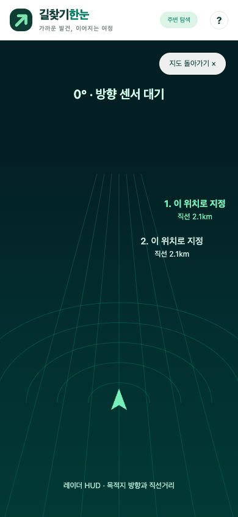

# Playwright 검증 및 수정 결과

- 검증일: 2026-10-31 (한국 시간)
- 대상: https://softm.github.io/gilchatgihannun/
- 도구: 연결된 Chrome의 Playwright locator, DOM 스냅샷 및 읽기 전용 DOM 평가. 지도 포인터처럼 의미 기반 locator로 드래그할 수 없는 조작은 같은 브라우저의 CUA 드래그를 사용했습니다.
- 화면: 기본 데스크톱 및 320×740, 390×844, 844×390.
- 검증한 배포 버전: `20261031.1`, 기능 소스 커밋 `6ed75d6d10b0fab810fa3ae9890f370535021b47`.

## 수정 사항

| 문제 | 수정 |
|---|---|
| HUD를 Esc로 닫은 뒤 레이더 탭이 계속 선택됨 | 모드 변경 함수에서 선택 탭·aria-pressed·HUD 표시 상태를 함께 갱신 |
| 수동 출발지를 선택해도 아래에는 현재 GPS 좌표 표시 | 출발지 좌표와 현재 GPS 정보를 구분하고 직접 지정 표시 |
| 새로고침하면 수동 출발지가 현재 위치로 바뀜 | 수동 출발지 저장·복원, 초기 위치 요청이 출발지를 덮어쓰지 않도록 변경 |
| 이전 탐색 좌표로 드래그가 다시 시작됨 | 드래그 시작 시 기준 좌표 초기화, 취소 시 탐색 상태 정리 |
| ‘다음 장소’의 좌표 항목이 이전 목적지 ID를 상속 | 검색 기준을 위경도만으로 정규화하고 좌표 선택 항목의 ID·이름·종류를 고정 |
| 지도 이동 중 메뉴 DOM이 반복 교체되어 클릭 대상이 바뀔 수 있음 | 기존 버튼·마커 유지, 위치만 갱신하고 프레임 단위로 조정 |
| 메뉴 갱신 직전의 목적지가 드롭 대상으로 남을 수 있음 | 드롭 시 실제 버튼 영역으로 선택 대상을 다시 판정 |
| 작은 화면에서 원형 메뉴와 하단 조작이 겹침 | 라벨 폭·하단 간격 조정, 낮은 화면에서는 스크롤 가능한 메뉴로 전환 |
| 배포 후 브라우저가 이전 JavaScript를 재사용 | HTML·CSS·모듈 파일에 일치하는 배포 버전 사용 |
| 카메라 권한 요청 후 지도 복귀 시 늦은 응답이 화면을 다시 열 수 있음 | 모드 요청 순번 확인, 사용하지 않는 스트림 즉시 종료 |

## 브라우저 재검사

| 시나리오 | 결과 |
|---|---|
| 다음 장소에서 직접 좌표 선택 항목 표시 | 통과 |
| 이전 목적지와 ID가 충돌하지 않고 새 목적지 추가 | 통과 |
| 순서 변경 후 지도 1번 마커가 이전 2번 위치로 이동 | 통과 |
| 실제 OSRM 차량 경로 표시 | 통과 |
| 목적지 삭제 시 이전 경로와 안내 영역 초기화 | 통과 |
| HUD → Esc → 지도 탭 복원 | 통과 |
| 수동 출발지 좌표 및 표시를 새로고침 후 유지 | 통과 |
| 지도 집중모드와 목록 숨김 | 통과 |
| 실제 포인터 드래그 후 날개 메뉴 표시 | 통과 |
| 낮은 화면에서 메뉴 전환 및 가로 넘침 없음 | 통과 |
| 테스트로 만든 목적지 정리 | 통과 |
| 목적지가 없으면 카메라 권한 요청 전에 안내 표시 | 통과 |
| 방문 순서 최적화 경로 응답 | 통과 |

총 13개 브라우저 시나리오 통과. 테스트 데이터 개수는 각 시나리오 실행 직전의 목록을 기준으로 비교했습니다. 순서 변경은 개수뿐 아니라 마커 위치 교환도 확인했습니다.

Node 회귀 테스트 14개 및 JavaScript 문법 검사도 통과했습니다. 추가 회귀 테스트는 잘못된 저장 JSON, 수동 출발지 복원, 좌표 항목 ID 상속 방지, 좁은 화면의 메뉴 간격을 다룹니다.

## 검증 한계

- 이번 검사에서 공개 주변 장소 서버의 지연·조회 실패가 재현됐습니다. 원격 서버의 가용성은 해결됐다고 보고하지 않습니다. 실패 중에도 좌표 직접 선택과 경로 계산을 계속할 수 있는 흐름을 검증했습니다.
- 실제 GPS 주행, 방향 센서 정확도, 카메라 영상, Android의 다른 앱 위 오버레이는 브라우저 검사로 검증하지 않았습니다.
- 목적지 없이 카메라 버튼을 누를 때 권한 요청을 막는 동작은 검증했으나, 카메라 권한 승인·기기 전환 등 전체 하드웨어 흐름은 실기기 검증 대상입니다.
- 개인정보가 표시되는 GPS 좌표·브라우저 로그·저장 데이터는 보고서와 스크린샷에 포함하지 않았습니다.

