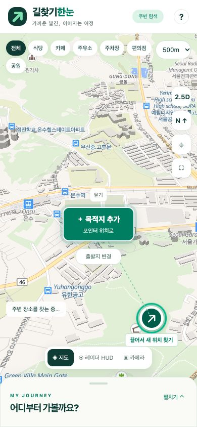

# 포인터와 목적지 선택 메뉴 개선

검증일: 2026-10-31 (한국 시간). 배포 버전: `20261031.4`.

## 개선

| 기존 문제 | 개선 |
|---|---|
| 지도를 이동하거나 목록이 펼쳐지면 탐색 포인터가 화면 밖·패널 뒤로 숨음 | 탐색 포인터를 지도 렌더러 밖의 독립 레이어로 옮기고, 지도·패널·모드 버튼을 고려한 표시 영역 안에 유지 |
| 화면 밖의 목적지까지 지도가 이동하면 포인터를 다시 찾기 어려움 | 화면 가장자리의 포인터를 그대로 끌어 새 위치를 탐색할 수 있도록 제공 |
| ‘이 위치로 지정 / 직접 선택’이 설명처럼 보임 | 중앙에 초록색 **＋ 목적지 추가** 버튼, 보조 문구 **포인터 위치로** 표시 |
| 중앙의 크고 어두운 ×가 선택보다 먼저 눈에 들어옴 | 큰 × 제거. 작은 **닫기** 버튼을 주요 추가 버튼과 분리 |
| 메뉴 보조 버튼이 포인터·지도 모드 버튼과 겹칠 수 있음 | 닫기·출발지 변경·더 보기의 위치와 간격 조정 |

원래 지점이 화면 밖에 있으면 탐색 포인터에 ‘끌어서 새 위치 찾기’를 표시합니다. 실제 GPS 위치는 별도의 파란색 위치 마커로 구분합니다.

## 검증

연결된 Chrome의 Playwright locator·DOM 평가 및 지도 드래그용 CUA로 확인했습니다.

- 초기 화면, 지도 이동 후, 목적지 추가 후, 목록 펼침·접힘 후 탐색 포인터 표시.
- 320×740, 390×844, 844×390에서 포인터의 실제 클릭 가능 여부.
- 중앙 추가 버튼을 눌렀을 때 실제로 목적지가 목록에 추가됨.
- 큰 중앙 × 제거, 작은 닫기 동작, 메뉴 닫은 후 포인터 유지.
- 주요 추가 버튼의 클릭 영역과 보조 버튼의 겹침 여부.
- 지도 모드 전환 버튼과 메뉴 보조 버튼의 분리.
- 포인터·메뉴 관련 브라우저 검사 14개 통과. 최종 배치에서는 닫기·출발지 변경·포인터·추가 버튼의 겹침도 재확인.
- Node 회귀 테스트 18개 통과. 화면 밖 포인터의 표시 범위 및 장소 1~5개와 중앙 버튼·보조 버튼 사이의 간격 검증 포함.
- 테스트에서 만든 목적지는 검증 후 삭제합니다. 아래 화면에는 실제 GPS 좌표·GPS 마커·개인 정보가 포함되지 않습니다.

## 개선 화면

